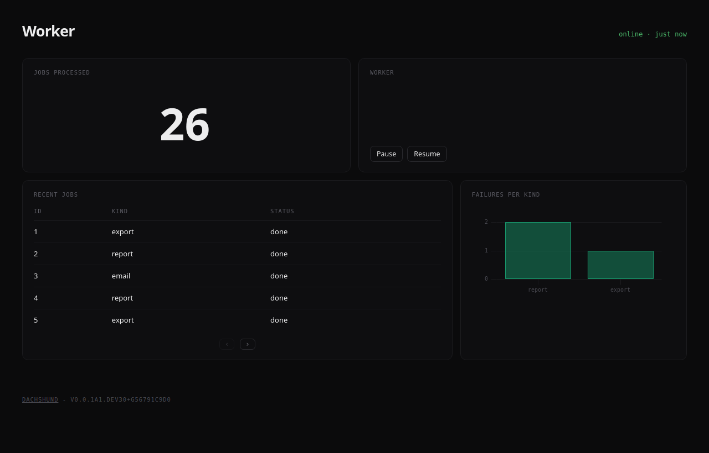

# Dachshund
> *A live admin dashboard for any Python service, embedded in the process itself.*

> **Beta.** Dachshund works, but its API may still change between releases. Pin a version before depending on it.



## What is Dachshund
Dachshund runs as a thread inside your web app, bot, worker or daemon. There's no router to hook into and no extra service to deploy. Declare pages and widgets in code, emit events from anywhere, and the dashboard updates live over WebSocket.

#### Key features
- **Embedded**: starts with your process, nothing else to run
- **Live**: every `emit()` reaches the open pages as it happens
- **Pages**: group widgets into pages and tabs, lay them out in rows and columns
- **Actions**: buttons that call your own Python functions
- **Extensible**: write your own widgets in a few lines of Python and JavaScript

## Getting Started

#### 1- Install the package

**Requirements:** Python 3.10 or higher

```bash
pip install --pre dachshund
```

`--pre` is needed while dachshund is in beta; pip skips pre-releases otherwise.

#### 2- Start the dashboard

Call `init()` once, when your application starts. The dashboard runs on a background thread for as long as your process does.

```python
import dachshund

dachshund.init("My service", description="What my service does")
```

#### 3- Add a page

`add()` puts a widget on the page, full width. Inside a `with page.row():` block, widgets sit side by side.

```python
from dachshund import Number, Page, TimeSeriesChart

page = Page("overview", title="Overview")
page.add(Number("users"))

with page.row():
    page.add(TimeSeriesChart("latency"))
    page.add(TimeSeriesChart("errors"))

dachshund.include(page)
```

#### 4- Emit events

A widget shows the events emitted under its name. Emit from anywhere in your code, on any thread.

```python
dachshund.emit("users", value=1204)
dachshund.emit("latency", value=96)
```

Start your application and visit http://127.0.0.1:1212.

#### Extra: exposing the dashboard

The dashboard has no authentication. Anyone who can reach its port sees every page and can run every action. Keep it on `127.0.0.1`, or put it behind a reverse proxy that authenticates.

To listen on every interface, for example inside a container:

```python
dachshund.init("My service", host="0.0.0.0", port=1212)
```

A reverse proxy must allow WebSocket upgrades on `/_ws`, which carries the live updates.

## Development
```bash
python -m venv venv
source venv/bin/activate
pip install -e ".[dev]"
```

Run the checks:

```bash
black dachshund/ tests/
mypy dachshund
pytest
```

## License
Dachshund is released under MIT.
