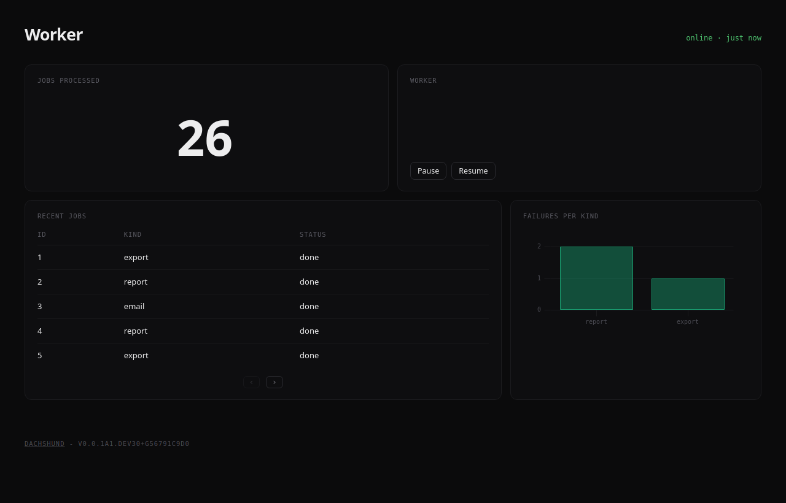

# Dachshund
> *A live admin dashboard for any Python service, embedded in the process itself.*



Dachshund runs as a thread inside your web app, bot, worker or daemon. There's no router to hook into and no extra service to deploy. Declare pages and widgets in code, emit events from anywhere, and the dashboard updates live over WebSocket.

- **Embedded**: starts with your process, nothing else to run
- **Live**: every `emit()` reaches the open pages as it happens
- **Pages**: group widgets into pages and tabs, lay them out in rows and columns
- **Actions**: buttons that call your own Python functions
- **Extensible**: write your own widgets in a few lines of Python and JavaScript

!!! warning "Beta"
    Dachshund works, but its API may still change between releases. Pin a version before depending on it.

## Getting Started

#### 1- Install the package

**Requirements:** Python 3.12 or higher

```bash
pip install --pre dachshund
```

`--pre` is needed while dachshund is in beta; pip skips pre-releases otherwise.

#### 2- Start the dashboard

Call `init()` once, when your application starts. The dashboard runs on a background thread for as long as your process does.

```python
import dachshund

dachshund.init("My service", description="What my service does")
```

#### 3- Add a page

Widgets live in rows: open one with `with page.row():`, then `page.add()` each widget. Widgets in a row sit side by side, and a row with one widget takes the full width.

```python
from dachshund import Page
from dachshund.widgets import Number, TimeSeriesChart

page = Page("overview", title="Overview")

with page.row():
    page.add(Number("users"))

with page.row():
    page.add(TimeSeriesChart("latency"))
    page.add(TimeSeriesChart("errors"))

dachshund.include(page)
```

#### 4- Emit events

A widget shows the events emitted under its name. Emit from anywhere in your code, on any thread.

```python
dachshund.emit("users", value=1204)
dachshund.emit("latency", value=96)
```

Start your application and visit [http://127.0.0.1:1212](http://127.0.0.1:1212).

!!! danger
    The dashboard has no authentication. Keep it on `127.0.0.1`, or see [Exposing the dashboard](guides/running.md#exposing-the-dashboard).

## Next steps

The guides go from here to bigger dashboards, in order:

1. [Running with Your App](guides/running.md): `init()` options, FastAPI, Flask, asyncio, several workers
2. [Pages & Layout](guides/pages.md): rows, columns, pages and tabs
3. [Widgets & Events](guides/widgets.md): which widget to use and what it reads
4. [Actions](guides/actions.md): buttons calling your Python functions
5. [Tables](guides/tables.md): keyed rows, row actions and rows loaded from your data
6. [Persistent Storage](guides/persistent-storage.md): keeping widget state across restarts
7. [Bigger Dashboard](guides/bigger-dashboard.md): one module per page
8. [Custom Widgets](guides/custom-widgets.md): your own widget, in Python and JavaScript
9. [Testing](guides/testing.md): checking pages, actions and loaders
